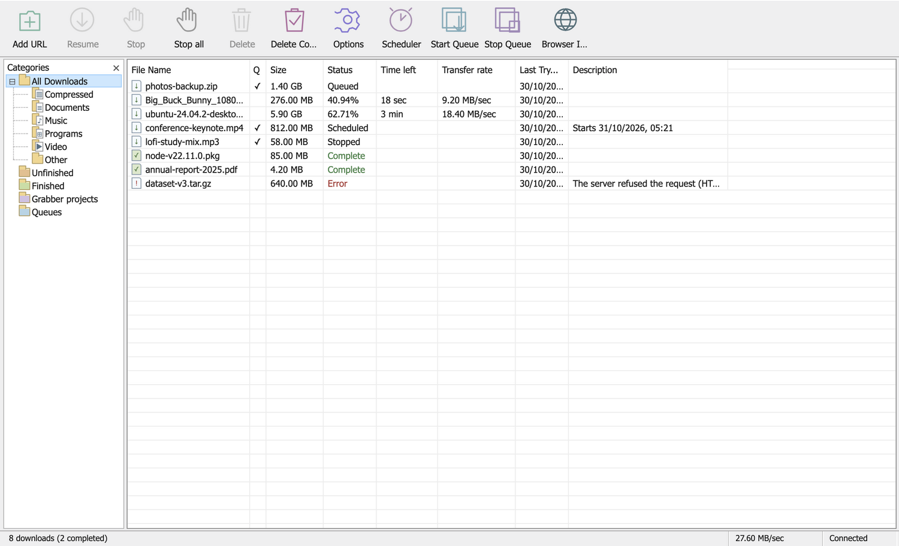
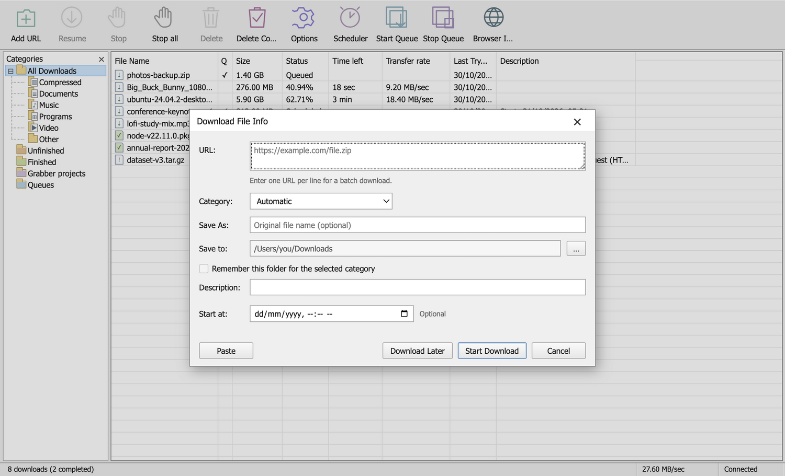
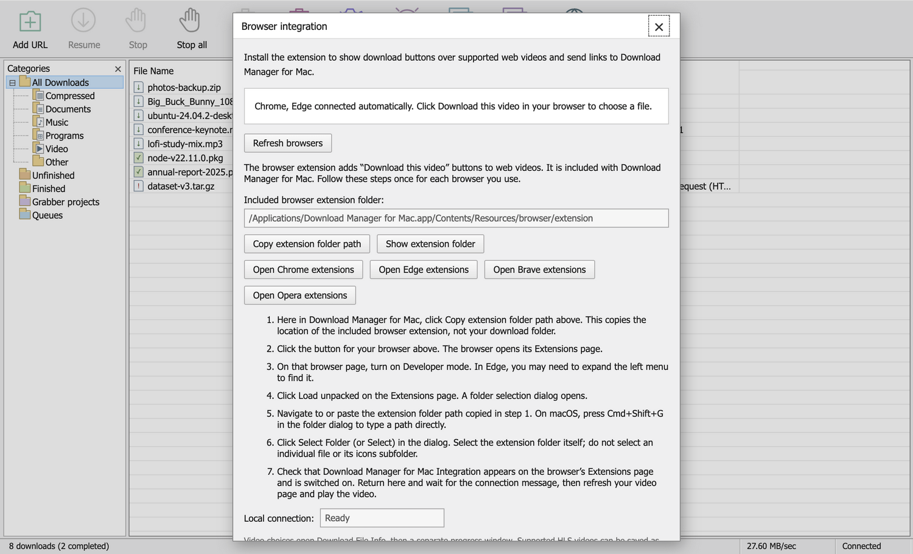

# Download Manager for Mac

A download manager for macOS with segmented transfers and one-click browser video
capture. Ships separate, tested builds for **Intel (x64)** and **Apple Silicon (arm64)**.
Each build bundles an ffmpeg and yt-dlp that match your Mac's chip, and CI checks that
on every release.

**Early preview:** private/sign-in-required pages, DRM and live media are unsupported.

## Download

Get the latest build from [Releases](https://github.com/asimsafeer/download-manager-for-mac/releases):

| Your Mac | File |
|---|---|
| Intel Mac | `Download-Manager-for-Mac-<version>-macOS-x64.dmg` |
| Apple Silicon (M1 or later) | `Download-Manager-for-Mac-<version>-macOS-arm64.dmg` |

Not sure which one you have? Apple menu > About This Mac. "Chip: Apple M…" means arm64;
"Processor: Intel …" means x64.

1. Open the DMG and drag **Download Manager for Mac** into **Applications**.
2. Open it once. macOS will warn that it cannot verify the app; see
   [First launch](#first-launch-macos-security-warning) below. This is expected for now.
3. Optional: check your download against the `SHA256SUMS-*.txt` file attached to the release
   with `shasum -a 256 -c SHA256SUMS-x64.txt` (or `-arm64`), run in the folder with the DMG.

## First launch (macOS security warning)

These builds are signed ad-hoc but **not notarized by Apple**, because notarization needs a paid
Apple Developer account (see [docs/NOTARIZATION.md](docs/NOTARIZATION.md)). The first time you open
the app, macOS therefore says it cannot verify it. Follow Apple's documented steps
([Safely open apps on your Mac](https://support.apple.com/en-us/102445)):

1. Double-click **Download Manager for Mac** in Applications. When macOS blocks it, click **Done**.
2. Open **System Settings > Privacy & Security** and scroll down to **Security**.
3. Next to the message that the app was blocked, click **Open Anyway**, enter your password if asked,
   then click **Open** in the prompt that appears.

After that, the app opens normally. On older macOS versions (Sonoma and earlier) you can also
right-click the app, choose **Open**, then confirm. Only do this for a copy you downloaded from this
project's [Releases](https://github.com/asimsafeer/download-manager-for-mac/releases) page.

If you prefer Terminal, this removes the download quarantine flag instead:

```bash
xattr -dr com.apple.quarantine "/Applications/Download Manager for Mac.app"
```

**First YouTube use:** the first time the app runs its bundled YouTube downloader, macOS checks
every file in it once. This can take a few minutes on a busy Mac. The app does this in the background
at launch; if you click a YouTube video too early it asks you to try again shortly.

## Features

- Multi-segment parallel HTTP(S) downloads, pause/resume, history, scheduling, speed limits.
- Chrome, Edge, Brave and Opera media detection and quality selection; video and audio
  tracks are combined locally with FFmpeg.
- Download File Info with custom save folder, categories, Download Later, and Start.
- Separate progress and completion windows; duplicate-download prevention.
- Menu bar tray, dock support and a native messaging bridge to the browser extension.

## Screenshots

Sample data; the app is shown as it looks on macOS.







## Browser extension setup (Chrome / Edge / Brave / Opera)

1. Click **Browser Integration** in the Download Manager for Mac toolbar.
2. Click **Copy extension folder path**, then **Open Chrome extensions** (or Edge).
3. Turn on **Developer mode** on the Extensions page.
4. Click **Load unpacked**, press **Cmd+Shift+G**, paste the path and select the folder.
5. The app connects to the extension automatically. Refresh a video page to see the button.

## Development

```bash
npm ci
npm test
npm start

npm run dist:x64     # Intel DMG + ZIP into release/
npm run dist:arm64   # Apple Silicon DMG + ZIP into release/
npm run verify:arch -- x64   # check the packaged ffmpeg / yt-dlp match the arch
```

Build each architecture on a matching Mac (or the matching GitHub runner, as the
release workflow does) so `ffmpeg-static` downloads the right ffmpeg.
`npm run dist*` also downloads and checksum-verifies the official yt-dlp one-directory build
(`yt-dlp_macos.zip`). `npm run package:extension` builds the browser-extension ZIP for store
submission (see [docs/EXTENSION-STORES.md](docs/EXTENSION-STORES.md)).

## Security and privacy

Report vulnerabilities privately; see [SECURITY.md](SECURITY.md). The app and its browser extension
send nothing to any server run by this project; see [docs/PRIVACY.md](docs/PRIVACY.md).

## Acknowledgements and license

Download Manager for Mac is a fork of [awesome-downloader-mac](https://github.com/abuzargifari/awesome-downloader-mac),
itself ported from [Awesome Downloader for Windows](https://github.com/TheAwesomeDeveloper/Awesome-Downloader-for-Windows).
Thanks to those authors. This project is not affiliated with them, or with Tonec Inc.
or Internet Download Manager.

Code added in this fork is licensed under [Apache-2.0](LICENSE). The portions derived from
awesome-downloader-mac remain under the original MIT License, whose copyright notice is kept
verbatim in [LICENSE-UPSTREAM-MIT](LICENSE-UPSTREAM-MIT) (see also [NOTICE](NOTICE)). Bundled
third-party components keep their own licenses: FFmpeg (GPL-3.0-or-later, via
`ffmpeg-static`), yt-dlp (Unlicense) and `googlevideo` (MIT). See
[THIRD-PARTY.md](THIRD-PARTY.md).
